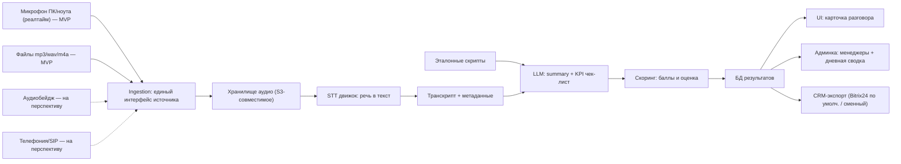

# ТЗ: MVP «Аудиобейдж» — AI-анализ коммуникаций менеджеров

## 1. Цель MVP

Получить **работающее, гибкое и расширяемое ядро (core)** анализа коммуникаций, а не «лишь бы работало». Ядро превращает аудио разговора в текст → summary → оценку по KPI → выгрузку в CRM, и спроектировано так, чтобы источник аудио и CRM-провайдер были сменными.

**Вход на этапе MVP — БЕЗ бейджей:**

- Захват звука с микрофона ноутбука/ПК в реальном времени.
- Работа с загруженными файлами (mp3/wav/m4a).

**На перспективу (заложить в архитектуру, не реализовывать сейчас):**

- Аудиобейджи как источник (iMED S28 / K2 и т.п.).
- Телефония (SIP/АТС) — всё в реальном времени.

Ключевой принцип: источник аудио (микрофон / файл / бейдж / телефония) — это **сменный адаптер** за единым интерфейсом; core ниже по потоку не зависит от того, откуда пришёл звук.

Пилот: 2-3 менеджера, 16-20 часов реальных переговоров для калибровки точности.

---

## 2. Scope

**В MVP входит:**

- Расширяемое ядро с абстракцией «источник аудио» (audio source) — реализованы 2 адаптера: файл и микрофон ПК/ноута (реалтайм).
- Захват с микрофона в реальном времени + ручная загрузка файлов (upload API).
- STT (речь → текст), язык по умолчанию RU (99,9% случаев) + автоопределение языка на уровне STT-движка для остальных случаев.
- Summary разговора.
- KPI-анализ через LLM: чек-лист по этапам продажи + бинарные/шкальные признаки (был ли CTA, обсуждалась ли цена, предложен ли замер и т.д.).
- Авто-скоринг (итоговая оценка +/-/~ и числовой балл).
- Выгрузка результата в CRM через сменный адаптер (по умолчанию — Bitrix24; fallback — JSON/webhook).
- Минимальный UI: список записей, статус обработки, карточка разговора (текст + summary + KPI + балл).
- **Админка:** управление менеджерами (CRUD) + дневная сводка по каждому менеджеру.
- **Загрузка эталонных скриптов** общения (опционально), которые используются как reference для скоринга.

**НЕ входит в MVP (осознанно, но архитектурно заложено):**

- Бейджи как источник (адаптер — на перспективу).
- Телефония / SIP-интеграция (адаптер — на перспективу).
- Точная диаризация (максимум базовая / опционально).
- Сложные многошаговые промпты и аналитика по когортам.
- Сложный дашборд.

> Примечание: реалтайм-захват с микрофона в MVP есть, но «тяжёлый» реалтайм-стриминг STT с низкой задержкой для телефонии — на перспективу. На MVP допустимо near-realtime (буферизация чанков → STT).

---

## 3. Архитектура (поток данных)

Источники слева — сменные адаптеры за единым интерфейсом. Сплошные линии — MVP, пунктир — на перспективу.



### 3.1 Принципы расширяемого ядра (core)

Цель — чтобы добавление бейджей и телефонии потом не ломало ядро. Подход — ports & adapters (гексагональная архитектура):

- **AudioSource (порт):** единый интерфейс источника. Адаптеры: `FileSource`, `MicSource` (MVP); `BadgeSource`, `TelephonySource` (на перспективу). Источник отдаёт нормализованный аудиопоток/файл + метаданные (менеджер, канал, время).
- **Нормализация на входе:** любой источник приводится к единому внутреннему формату (sample rate/кодек) до STT, чтобы downstream не зависел от железа.
- **STTEngine (порт):** интерфейс «аудио → транскрипт с таймкодами». Реализации заменяемы (self-host whisper / облако) без правок выше.
- **Analyzer (порт):** интерфейс «транскрипт + скрипт → summary + KPI JSON». LLM-провайдер заменяем.
- **CRMExporter (порт):** интерфейс выгрузки в CRM. Провайдер — сменный адаптер: `Bitrix24Exporter` (по умолчанию на MVP), `AmoCRMExporter`, `GenericWebhookExporter`, `JSONExporter` и т.п. Выбор провайдера — через конфиг/настройки в админке.
- **Очередь задач + статусная модель** общие для всех источников: загрузка/захват только кладёт «job» в пайплайн, дальше обработка одинаковая.
- **Конфиг-driven:** список KPI, веса, активный STT/LLM-провайдер, CRM-провайдер, язык по умолчанию, источники — через конфиг/БД, не хардкод.
- Реалтайм vs batch: внутренний контракт один (на выходе всегда транскрипт+метаданные), отличается лишь способ доставки чанков. MVP-микрофон работает в near-realtime (буфер чанков → STT).

---

## 4. Функциональные блоки (описательно)

### 4.1 Источники аудио (audio sources)

- **MVP — `FileSource`:** веб-форма drag&drop + `POST /api/uploads` (multipart), форматы mp3/wav/m4a, валидация формата/длительности.
- **MVP — `MicSource`:** захват с микрофона ПК/ноута в реальном времени (старт/стоп записи из UI), near-realtime передача чанков в пайплайн.
- **На перспективу — `BadgeSource`:** импорт записей с бейджа (ручной слив / app / API устройства).
- **На перспективу — `TelephonySource`:** интеграция с АТС/SIP, запись звонков в реальном времени.
- Все источники реализуют общий порт `AudioSource` и кладут job в единую очередь.
- Метаданные job: менеджер, дата/время, канал (живой/телефон/микрофон), согласие клиента (флаг).

### 4.2 STT (речь → текст)

- На вход — аудио (файл или near-realtime чанки), на выход — текст с таймкодами (по сегментам).
- Реализация за портом `STTEngine` — заменяема без правок пайплайна.
- **Язык:** по умолчанию RU (задаётся в конфиге). STT-движок автоматически определяет язык аудио; если определённый язык отличается от ожидаемого — сохраняем detected language в метаданных транскрипта (полезно для аналитики/фильтрации).
- Требование к точности: измеряем WER на 16-20 ч размеченного датасета.
- Базовая «диаризация» — опционально, через сегменты STT (speaker turns), без точного разделения голосов.

### 4.3 Summary

- Краткое содержание разговора (3-7 пунктов): запрос клиента, что предложили, договорённости, next step.

### 4.4 KPI-анализ (ядро ценности)

- LLM по транскрипту заполняет структурированный чек-лист (строгий JSON-вывод).
- **Классические KPI:** приветствие, выявление потребности, работа с возражениями, оффер, завершение сделки, соблюдение регламента/скрипта, тональность общения.
- **Кастомные бинарные/факт-признаки:** был ли CTA, обсуждалась ли цена, предложен ли замер, и т.п. (список — настраиваемый конфиг, не хардкод).
- Для каждого пункта: значение (да/нет/частично), цитата-доказательство из транскрипта, краткий комментарий.
- **Скрипт опционален.** Два режима, выбираются автоматически:
  - *Baseline (скрипта нет):* оценка по generic KPI-рубрике из конфига — работает всегда.
  - *Script-based (скрипт есть):* к baseline добавляется строгая сверка с эталоном (пункт «соблюдение регламента» + поиск нарушений).

### 4.5 Скоринг

- Веса по пунктам (конфиг) → числовой балл 0-100 + сводная оценка `+ / ~ / -`.
- Если скрипт привязан — поиск нарушений = сверка с активным эталоном (см. 4.9): пункты регламента со значением «нет». Если скрипта нет — пункт «соблюдение регламента» либо исключается из расчёта, либо оценивается по общим критериям (флаг в конфиге).
- Веса нормализуются под доступный набор пунктов, чтобы baseline и script-based баллы были сопоставимы.
- Оценка ссылается на версию конфига весов и (если был) версию скрипта — для воспроизводимости.

### 4.6 Выгрузка в CRM (сменный провайдер)

- CRM-провайдер — сменный адаптер за портом `CRMExporter`. Выбирается в настройках (конфиг / админка).
- **MVP — `Bitrix24Exporter` (по умолчанию):** через REST/webhook (создание/обновление сущности — дело/комментарий/поле сделки). На пилоте достаточно webhook-исходящего.
- **`GenericWebhookExporter`:** отправка JSON-payload на произвольный URL (fallback / интеграция с чем угодно).
- **`JSONExporter`:** выгрузка в файл (для отладки / ручного импорта).
- **На перспективу:** `AmoCRMExporter`, `HubSpotExporter` и т.п. — добавляются как новые адаптеры без правок ядра.

### 4.7 UI (минимум)

- Список записей со статусами (загружено / в обработке / готово / ошибка).
- Карточка: плеер + транскрипт + summary + KPI-таблица с цитатами + балл.
- Возможность ручной корректировки оценки (для калибровки разметки).

### 4.8 Админка (управление менеджерами + дневная сводка)

- **Управление менеджерами (CRUD):** ФИО, роль/должность, привязка к бейджу (серийник/ID устройства), статус активен/неактивен, привязка к скрипту по умолчанию.
- **Привязка записей к менеджеру:** при загрузке выбирается менеджер (вручную или по ID устройства).
- **Дневная сводка по каждому менеджеру:** за выбранную дату — кол-во разговоров, суммарная/средняя длительность, средний балл, разбивка по KPI (% выполнения каждого пункта), список нарушений скрипта, топ проблемных пунктов.
- Фильтры: менеджер + дата (плюс диапазон дат на вырост).
- Роли доступа (минимум): админ (всё) / просмотр (руководитель). Аутентификация — простая (логин/пароль), без сложного RBAC на MVP.

### 4.9 Эталонные скрипты (опциональный reference для скоринга)

- **Скрипт не обязателен:** без него система работает в baseline-режиме (см. 4.4/4.5). Скрипт лишь уточняет и ужесточает оценку регламента.
- **Загрузка скриптов** через админку: текст/файл (txt/docx/markdown), название, версия, привязка к этапам продажи/KPI.
- Скрипт = эталон ожидаемых фраз/шагов (приветствие, выявление потребности, оффер, отработка возражений, CTA, завершение).
- При анализе LLM сверяет транскрипт с активным скриптом: какие шаги соблюдены, где отклонения, цитаты-доказательства → влияет на KPI «соблюдение регламента» и поиск нарушений.
- Версионирование скриптов: храним историю, чтобы старые оценки оставались воспроизводимыми (оценка ссылается на версию скрипта).
- Возможность иметь несколько скриптов (разные сценарии/каналы) и выбирать активный per-менеджер или per-канал.

---

## 5. Список KPI (стартовый, выносим в конфиг)

| # | KPI | Тип |
|---|-----|-----|
| 1 | Приветствие / установление контакта | шкала |
| 2 | Выявление потребности | шкала |
| 3 | Презентация / оффер | шкала |
| 4 | Работа с возражениями | шкала |
| 5 | Обсуждение цены | факт (да/нет) |
| 6 | CTA / призыв к действию | факт (да/нет) |
| 7 | Предложение замера | факт (да/нет) |
| 8 | Завершение сделки / next step | шкала |
| 9 | Соблюдение регламента-скрипта | шкала (только при наличии скрипта) |
| 10 | Тональность / вежливость | шкала |

---

## 6. Инструменты и инфраструктура — НА ПОДУМАТЬ (с trade-off'ами)

### Главная развилка — приватность (юр. момент РБ, записи клиентов)

| | Вариант A — облачные API | Вариант B — self-hosted |
|---|---|---|
| Скорость старта | Быстрее | Дольше (DevOps) |
| Приватность | Данные уходят за периметр | Данные на своём сервере |
| Юр. риск (РБ) | Надо проверить согласие на передачу | Безопаснее |
| Доступность из РБ | Уточнить оплату/регион | Не зависит |
| Стоимость | Pay-per-use | GPU-нода (аренда или покупка) |

### STT (на подумать)

- `whisper.cpp` / `faster-whisper` (self-host, RU ок) — баланс цена/качество.
- Облачный Whisper API / Deepgram / AssemblyAI — быстрее интегрировать, хуже по приватности; уточнить поддержку RU и доступность из РБ.

### LLM для KPI/summary (на подумать)

- Облако: GPT-class модели (structured outputs / JSON mode) — лучшее качество промпт-инжиниринга «из коробки».
- Self-host: Qwen / Llama-class open-weights под структурированный вывод — приватность, но нужен GPU и тюнинг промптов.

### Бэкенд (на подумать)

- Python (FastAPI) — естественно для ML/STT, async-очереди.
- Очередь обработки: Redis + RQ/Celery (или встроенный background-воркер для MVP).

### Хранилище

- Аудио: S3-совместимое (MinIO для self-host / S3).
- Метаданные/результаты: PostgreSQL.

### Реалтайм-захват микрофона (на подумать)

- Браузер: `MediaRecorder` / WebAudio → отправка чанков по WebSocket на бэкенд (проще всего, кроссплатформенно).
- Альтернатива: лёгкий desktop-агент на ПК менеджера (надёжнее для постоянной работы, дороже в поддержке).
- Транспорт чанков: WebSocket для near-realtime; на перспективу для телефонии — медиапоток (RTP/SIP) через шлюз.

### Фронтенд (на подумать)

- Лёгкий: Next.js / React + простой UI-kit. Для MVP можно даже server-rendered минимум.
- Админка может быть тем же фронтом с отдельными ролями/роутами.

### Инфра/деплой (на подумать)

- Docker Compose на одном VPS для пилота (api + worker + db + minio + reverse-proxy).
- GPU-нода только если выбран self-host STT/LLM.

---

## 7. Подход к настройке модели (тюнинг vs промпт+скрипты)

- **Fine-tuning на MVP не нужен.** Настройка качества — через промпт-инжиниринг, конфиг KPI/весов и (опционально) эталонные скрипты в контексте.
- **Скрипты — это контекст для LLM, а не данные для обучения весов.** Их наличие необязательно (см. 4.4/4.9).
- **STT:** вместо дообучения — словарь/`initial_prompt` с названиями товаров, именами, терминами. Fine-tuning STT — только если WER реально страдает из-за акцента/специфики (перспектива).
- **LLM-анализатор:** структурированный промпт + few-shot примеры из размеченного датасета. 16-20 ч разметки используем как eval-набор (мерить accuracy) и источник few-shot, не как train.
- **Когда fine-tuning оправдан (перспектива):** промпт+few-shot вышли на плато при сотнях+ размеченных примеров, либо нужно удешевить/ускорить через дистилляцию в маленькую локальную модель.

---

## 8. Юридический момент (РБ)

- Перед записью — согласие/уведомление клиента (готовит заказчик).
- В системе: хранить флаг «согласие получено», ограничить доступ к записям, задать срок хранения/удаление.
- Это влияет на выбор облако vs self-host (вариант B безопаснее юридически).

---

## 9. Данные и метрики качества

- Собрать 16-20 ч реальных переговоров, разметить вручную (KPI + «золотой» транскрипт на сэмпле).
- Метрики: WER для STT, accuracy/F1 по каждому KPI-пункту против ручной разметки.
- Калибровка промптов/весов до приемлемой точности.

---

## 10. Модель данных (ориентир)

```
manager        — id, ФИО, должность, device_id, активен, default_script_id (nullable)
script         — id, название, версия, контент, привязка к KPI/этапам, активен (опционально)
recording      — id, manager_id, дата/время, канал, согласие_флаг, путь_к_аудио, статус
transcript     — id, recording_id, текст, сегменты/таймкоды, detected_language
analysis       — id, recording_id, summary, kpi_json, балл, оценка,
                 режим (baseline/script-based), script_version_id (nullable), weights_version
user           — id, логин, хэш пароля, роль
```

---

## 11. Этапы

### MVP (без бейджей, вход = микрофон ПК + файлы)

1. Каркас ядра: порты `AudioSource / STTEngine / Analyzer / Exporter` + очередь + статусная модель.
2. Адаптеры источников: `FileSource` (upload) и `MicSource` (реалтайм-захват) → нормализация → хранилище.
3. STT за портом → транскрипт.
4. LLM: summary + KPI JSON + скоринг (сверка с эталонным скриптом, если есть).
5. Минимальный UI + ручная корректировка для разметки.
6. Админка: менеджеры (CRUD) + загрузка скриптов + дневная сводка.
7. Выгрузка в CRM (Bitrix24 по умолчанию) + адаптеры webhook/JSON.
8. Сбор 16-20 ч датасета, замер точности (WER + KPI accuracy), калибровка.

### Перспектива

9. Hardware-тест бейджей (iMED S28/K2) + адаптер `BadgeSource`.
10. Телефония: адаптер `TelephonySource` (SIP/АТС), реалтайм с низкой задержкой.
11. Масштабирование на остальных специалистов.

---

## 12. Перспективные апгрейды (после MVP, НЕ задачи MVP)

Идеи. В MVP не входят — закладываем как направления развития.

1. **Акустические/диалоговые метрики без LLM.** Из таймкодов STT/VAD: talk-to-listen ratio, длина самого длинного монолога, темп речи (слов/мин), паузы, перебивания (overlap), доля тишины. Дёшево, объективно, язык-агностично; объективный слой поверх «мягкой» LLM-оценки.
2. **Поведенческие якоря в рубрике вместо прилагательных.** Для каждого KPI задавать якоря (например, *0 = не представился; 5 = представился; 10 = представился + имя клиента + цель*) — снижает разброс и галлюцинации оценок LLM.
3. **Двухуровневый LLM (cost optimization).** Бинарные факт-признаки (CTA/цена/замер) — дешёвой моделью; нюансная оценка (возражения, тональность, регламент) — сильной. Длинные звонки — map-reduce по чанкам вместо одного большого контекста.
4. **VAD-преднарезка тишины перед STT.** Убирать тишину/музыку ожидания до STT — режет время и стоимость STT (особенно для near-realtime и будущей телефонии).
5. **RU-native managed STT как опция облака.** Рядом с Whisper — Yandex SpeechKit / Sber SaluteSpeech: лучше по RU и данные в RU/РБ-дружественной юрисдикции (важно для юр-момента).
6. **Привязка KPI к известной методологии (SPIN/BANT/MEDDIC).** Маппинг конфига KPI на готовый фреймворк (для шоурум-продаж — SPIN) снижает риск «выдуманной» рубрики и упрощает промпт.
7. **Regression-харнесс для промптов.** Golden-set + автотест: при каждом изменении промпта прогон по эталонным звонкам и сравнение accuracy/F1, чтобы правка не уронила метрику молча.
8. **Sentiment/тональность отдельным проходом по сегментам.** «Эмоциональная кривая» разговора почти даром, улучшает summary.
9. **Confidence + human-in-the-loop.** Помечать низкоуверенные оценки на ручную проверку; поток данных для few-shot и калибровки.
